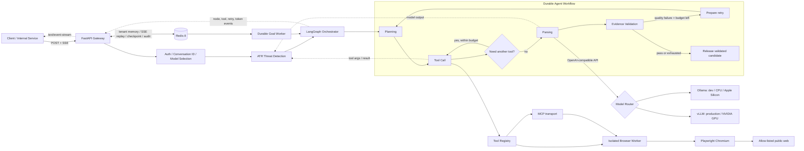

# AI Operations Gateway

一個可執行的企業級 AI 運維與資料處理 Gateway 骨架，整合 FastAPI、SSE、
LangGraph、Playwright、MCP、Redis，以及可互換的 Ollama / vLLM 推理後端。

## 系統架構



### 技術選型與邊界

- **FastAPI**：非同步 API、OpenAPI 與 SSE；事件 ID 使用 Redis Stream ID，支援 heartbeat、
  `Last-Event-ID` replay，以及 process 中斷後從 LangGraph checkpoint 明確 resume。
- **OpenAI-compatible adapter**：Ollama 與 vLLM 都走 `/v1`，上層不需要知道實際
  推理引擎。Ollama 適合開發，vLLM 適合 GPU batching、prefix cache 與高吞吐。
- **LangGraph**：把「規劃、工具、解析、證據檢核、修正重試、輸出」顯式建模。成功路徑
  直接串流已驗證 candidate，不再二次生成未驗證答案。工具會依前一步 observation 進行
  多輪 ReAct 決策，並受 `max_tool_rounds` 控制。官方 Redis checkpointer 保存 node state。
- **Evidence Validation**：逐來源重算 SHA-256、驗證 provenance、追蹤 `[source:N]` claim、
  驗證 claim 是否引用正確來源、拒絕錯置／無來源數值，計算 lexical support，並揭露多來源
  數值衝突。它是可稽核的 deterministic evidence gate，不宣稱等同完整 NLI 事實查核。
- **Playwright + MCP**：Tool Registry 支援 local、MCP stdio 與內網 Browser Worker transport；
  模型可選擇工具，click/type 需要 client 明確列入 `approved_tools`。Browser Worker 具備
  session TTL、操作 lock、SSRF/redirect/allow-list 與輸出大小控制。
- **Redis**：所有對話、run、Goal、audit key 以 tenant 分區；保存 rolling summary、相關
  長期記憶、SSE event、LangGraph checkpoint。Goal 使用 Consumer Group、ACK、lease reclaim
  與 dead-letter stream。
- **安全與治理**：支援多租戶 API key、OIDC/JWKS JWT、RBAC、rate/concurrency/token quota、
  PII redaction、模型 allow-list、內容政策、checkpoint-backed human approval、取消與 deadline。
- **繁中管理台與協作**：`/console/` 提供 OIDC code＋PKCE／server-side session 管理台、YAML 與
  唯讀 DAG、planning SSE、opt-in human presence、Agent heartbeat，以及 HMAC outbound 通知。
- **Agent Threat Rules (ATR)**：載入 `pyatr` 規則，自動掃描 user/Goal input、tool call、
  Playwright/MCP response、Goal planner 與 model output。預設為 detection-only；可依 severity
  開啟 blocking。事件與 audit 不包含原文或命中的 regex，避免安全遙測二次洩密。
- **可觀測性**：`/metrics` 提供 HTTP、TTFT、token、tool、retry、Evidence Validation、active-run 指標；
  provider 有回報 usage 時，記錄精確 input/output token 與依模型 route 設定計算的 USD 成本。
  設定 OTLP endpoint 後啟用 OpenTelemetry tracing。對外不回傳 hidden chain-of-thought。

### 架構演進與公開討論

[`docs/architecture/buzz-inspired-roadmap.md`](docs/architecture/buzz-inspired-roadmap.md) 記錄從
[Buzz](https://github.com/block/buzz) 提煉出的架構參考，以及本專案對 durable event store、統一
event envelope、Agent identity、tamper-evident audit 與 per-conversation single-flight 的分階段
評估。這是一份 proposal／decision record，不代表列出的能力已經實作。

後續設計討論採「GitHub Discussion 記錄探索，repository 文件保存決策」的方式；目前 repository
尚未啟用 GitHub Discussions，因此先由
[`docs/architecture/discussion-log.md`](docs/architecture/discussion-log.md) 保存起始紀錄與未決問題。
啟用 Discussions 並建立主題後，應將連結回填到這兩份文件。

## 目錄

完整待辦與分階段交付見[實作追蹤](docs/implementation-roadmap.md)；
本次安全行為變更見[M1 完整掃描／journal 紀錄](docs/releases/2026-10-27-m1-safety.md)。

管理台登入、CSRF、presence／heartbeat 與通知維運見
[繁中管理台、協作與通知](docs/console-collaboration.md)。

支援 ACP v1 的編輯器可用 `ai-ops-gateway-acp` stdio adapter 連線至遠端 Gateway；session、
串流、取消與逐次核准映射見 [ACP v1 遠端 Adapter](docs/acp-adapter.md)。

Gateway 規劃 session、不可變計畫／設定快照與不自動執行的模式切換，見
[規劃模式操作指南](docs/plan-mode.md)。時間／token 情境預測與校正見
[plan-forecast](docs/plan-forecast.md)；明確且冪等的執行 admission 見
[Workflow Plan v2](docs/workflow-plan-v2.md)。

這版已完成項目、尚未納入功能、完整測試與整合驗證結果，統一見
[2026-10-26 Skill／plan mode 封版紀錄](docs/releases/2026-10-26-skills-plan-mode.md)。

```text
app/
├── api/                 # HTTP schema 與 SSE endpoint
├── core/                # settings、Redis、security、observability
├── graph/               # LangGraph state 與 workflow
├── llm/                 # Ollama/vLLM 共用模型 adapter
├── tools/               # Playwright、Tool Registry、MCP/remote transports
├── browser_worker.py    # 隔離 Chromium service
├── main.py              # FastAPI app factory
└── mcp_server.py        # stdio MCP server
```

## 本機啟動

```bash
cp .env.example .env
python -m venv .venv
source .venv/bin/activate
pip install -e '.[dev]'
playwright install chromium
uvicorn app.main:app --reload
```

另一個終端啟動本機 Ollama，或使用 Compose：

```bash
# macOS / CPU-friendly profile
docker compose --profile ollama up --build

# NVIDIA host; first update .env to point at http://vllm:8000/v1
docker compose --profile vllm up --build
```

`gateway` 不硬性依賴任一模型 container，因此也能連到外部 GPU inference cluster。

## SSE 呼叫

```bash
curl -N http://localhost:8000/v1/agent/stream \
  -H 'content-type: application/json' \
  -H 'x-api-key: change-me' \
  -d '{
    "query": "摘要頁面的主要公告，列出三個重點",
    "conversation_id": "announcement-review",
    "model": "qwen2.5:7b",
    "source_urls": ["https://example.com", "https://www.iana.org/help/example-domains"],
    "max_retries": 2,
    "max_tool_rounds": 8,
    "deadline_seconds": 300
  }'
```

事件類型包含：`accepted`、`node_status`、`tool_status`、`threat_detection`、`approval_required`、
`model_usage`、`draft_token`、`evidence_validation`、`retry`、`token`、`completed`、
`cancelled`、`error`。`draft_token` 是尚未通過
Evidence Validation 的真實模型串流，只適合即時預覽與 TTFT；正式答案應使用驗證後的
`token`／`completed.answer`。註解 heartbeat 不會觸發 EventSource message handler。

## Agent Threat Rules 自動檢測

Gateway 使用 [ATR / pyatr](https://github.com/dc-tw/agent-threat-rules) 的 Layer-1 規則引擎。
偵測預設開啟但不阻擋，以便先觀察 false positive；正式環境可設定：

```env
ATR_ENABLED=true
ATR_BLOCKING=true
ATR_MIN_SEVERITY=medium
ATR_BLOCK_SEVERITY=high
```

當 `ATR_BLOCKING=true` 時，達門檻的 request/Goal 會收到 HTTP 403；工具內容會在進入
LLM context 前被隔離，模型輸出則先完整緩衝並通過掃描後才送出 `draft_token`。因此阻擋模式
刻意犧牲 generation TTFT，換取「未掃描內容不先洩漏」的保證。`ATR_RULES_DIR` 可改用企業自訂
YAML 規則目錄；留空時使用 `pyatr` bundled rules。`GET /healthz` 顯示規則數與 blocking 狀態，
Prometheus 提供 `ai_gateway_threat_detections_total` 與 `ai_gateway_threat_blocks_total`。

### Detection-only 校準與正式阻擋

Detection-only 命中會在 Redis 保存 30 天的 privacy-safe metadata，包括 rule、severity、
event boundary、model、request/Goal ID 與審查狀態；不保存 prompt、網頁內容或 matched regex。
安全管理者可列出 finding 並標記結果：

```bash
curl 'http://localhost:8000/v1/security/threat-findings?review_status=unreviewed' \
  -H 'x-api-key: ADMIN_KEY'

curl -X POST http://localhost:8000/v1/security/threat-findings/FINDING_ID/review \
  -H 'content-type: application/json' -H 'x-api-key: ADMIN_KEY' \
  -d '{"verdict":"false_positive","reason":"Approved internal red-team phrase"}'

curl http://localhost:8000/v1/security/threat-findings/stats/rules \
  -H 'x-api-key: ADMIN_KEY'
```

Rule statistics 會回傳 reviewed sample、false-positive rate 與 `recommended_for_blocking`。
預設建議門檻是至少 20 個已判定 true/false-positive 樣本且誤判率不超過 5%。建議 rollout：

1. 保持 `ATR_BLOCKING=false` 蒐集並人工標記資料。
2. 將達標規則寫入 `ATR_BLOCKING_RULE_IDS`；已知誤判規則寫入
   `ATR_BLOCKING_EXCLUDED_RULE_IDS`。
3. 在 staging 設定 `ATR_BLOCKING=true`，確認 SSE、工具與 Goal 行為。
4. production 逐批加入規則；若誤判升高，以 excluded list 即時停止該規則阻擋。

系統不會因統計結果自行切換 production enforcement；切換必須經設定變更與部署審核。

可重現的邊界測試、人工審查流程、延遲量測方式與限制整理在
[`docs/atr-evaluation/`](docs/atr-evaluation/README.md)。其中明確區分控制流程測試、合成語料與
部署量測，避免把規則命中誤寫成已證實攻擊，或把單元測試誤寫成 production benchmark。

同一個 `conversation_id` 會載入 Redis 的近期訊息、rolling summary 與相關長期記憶；
下一輪可指定另一個 allow-listed `model`。`LLM_ROUTES_JSON` 在伺服器端把 alias 映射到
不同 Ollama／vLLM endpoint；客戶端不能提交推理 URL 或任意模型名稱。

```env
LLM_ROUTES_JSON={"ollama-qwen":{"base_url":"http://ollama:11434/v1","model":"qwen2.5:7b","api_key":"local-only"},"vllm-qwen":{"base_url":"http://vllm:8000/v1","model":"Qwen/Qwen2.5-7B-Instruct","api_key":"local-only"}}
```

每個 route 可另設 `input_cost_per_million` 與 `output_cost_per_million`。若 Ollama／vLLM
未回報 usage，事件會標記 `provider_reported=false`，不會把估算值偽裝成精確成本。

可透過 `GET /v1/models` 取得允許選擇的模型／alias（不會暴露 API key 或 endpoint）。

```bash
curl http://localhost:8000/v1/conversations/announcement-review \
  -H 'x-api-key: change-me'
```

斷線後使用首次回應的 `X-Request-ID` replay；若 API process 曾中斷，先要求 checkpoint resume：

```bash
curl -X POST http://localhost:8000/v1/agent/runs/REQUEST_ID/resume \
  -H 'x-api-key: change-me'
curl -N http://localhost:8000/v1/agent/runs/REQUEST_ID/events \
  -H 'Last-Event-ID: 0-0' -H 'x-api-key: change-me'
```

危險工具會讓 run 進入 `waiting_approval`。核准、拒絕或取消：

```bash
curl -X POST http://localhost:8000/v1/agent/runs/REQUEST_ID/approval \
  -H 'content-type: application/json' -H 'x-api-key: change-me' \
  -d '{"approved":true,"reason":"Reviewed target and selector"}'
curl -X POST http://localhost:8000/v1/agent/runs/REQUEST_ID/cancel \
  -H 'x-api-key: change-me'
```

## MCP tool

```bash
python -m app.mcp_server
```

MCP client 可把上述命令註冊為 stdio server，並取得：

- `scrape_dynamic_page`
- `browser_start`
- `browser_click`
- `browser_type`
- `browser_screenshot`
- `browser_close`

`browser_start` 回傳 `session_id`；後續操作沿用 Browser Worker 中同一個隔離 Chromium
context。內建 MCP client 維持單一長連線 stdio session，不會每個 tool call 重啟 server。
Session 有 TTL 與數量上限，輸入/點擊只接受 selector，不提供任意 JavaScript eval。

## Skill 管理

Gateway 提供 tenant-scoped Skill registry、不可變 revisions、Agent 明確版本綁定、啟停／撤銷、
rollback 與 `SKILL.md` 文字匯出。Skill 是可重用的指令流程，不會新增工具或放寬既有權限。
內建十種繁中工作流程可由管理者選擇安裝；詳見[管理指南](docs/skill-management.md)與
[內建 Skill 清單](docs/skills-catalog.md)。

新增的 opt-in v2 模式／唯讀資源、獨立規劃綁定與確定性自動選擇，見
[Skill v2 指南](docs/skills-v2.md)。另提供[唯讀套件匯入](docs/skill-package-import.md)；
Skill 選擇的 plan-only forecast estimator 見 [plan-forecast 指南](docs/plan-forecast.md)。

## PostgreSQL 歷史儲存

可選的 owner／明確分享隔離見[資源 ACL 操作指南](docs/resource-access.md)。預設不啟用，
舊資料需 admin 明確認領；這不是完整的 Agent 憑證或對話併發治理。

可選啟用 Postgres 長期歷史、分頁與中繼資料搜尋；Redis 仍負責即時執行、核准、額度、queue
及 checkpoint。提供原子 outbox、可重送 projector、回填／對帳、明確歷史切讀與保留政策，
不將過期的歷史快照當作執行授權。

操作見 [Postgres 指南](docs/postgres-history.md)、[ADR-002](docs/architecture/adr-002-postgres-history.md)
及[實際驗證紀錄](docs/postgres-verification-2026-10-27.md)。預設不啟用，既有 Redis-only 部署不變。

## Durable Goal Mode

定時、webhook、內部事件、Agent persona 與 Chief 派工的設定及操作方式，見
[`docs/proactive-agents.md`](docs/proactive-agents.md)。可為每個 Agent 獨立設定職責、persona、模型與
權限；Chief 將主要任務委派給核准的 Worker Agent，等待後彙整。主動工作由獨立 scheduler 建立
Goal，與一般請求共用 ATR、quota、checkpoint、逐次 human approval 與持久化事件。

Goal state、步驟與事件保存在 Redis，由 Compose 中獨立的 `worker` 執行。未提供 `steps`
時，worker 會要求選定模型拆解成有限步驟；也可由呼叫端明確指定可稽核的步驟。

```bash
curl -X POST http://localhost:8000/v1/goals \
  -H 'content-type: application/json' \
  -H 'x-api-key: change-me' \
  -d '{
    "objective": "研究三個來源並產生摘要",
    "model": "qwen2.5:7b",
    "steps": [
      {"query": "整理來源 A"},
      {"query": "整理來源 B"},
      {"query": "綜合比較"}
    ]
  }'
```

```bash
curl -X POST http://localhost:8000/v1/goals/GOAL_ID/pause \
  -H 'x-api-key: change-me'
curl -X POST http://localhost:8000/v1/goals/GOAL_ID/resume \
  -H 'x-api-key: change-me'
curl -N http://localhost:8000/v1/goals/GOAL_ID/events \
  -H 'x-api-key: change-me'
curl -X POST http://localhost:8000/v1/goals/GOAL_ID/cancel \
  -H 'x-api-key: change-me'
```

Pause 是 cooperative：正在執行的 Agent 會在下一個 LangGraph event 邊界停止；resume
重新排入 Redis Stream。Worker 非正常中斷時，lease 到期後由 Consumer Group reclaim，
並利用同一個 step thread ID 從 Redis checkpoint 恢復。

## Kubernetes / HA baseline

[`deploy/kubernetes`](deploy/kubernetes/) 提供 Kustomize baseline：
Gateway 3 replicas、Worker 2 replicas、Scheduler 2 replicas、Browser Worker 2 replicas、HPA、PDB、non-root／read-only
security context、NetworkPolicy，以及 Browser Worker 的 ClientIP session affinity。部署前必須建立
`ai-ops-gateway-secrets`；[`secret.example.yaml`](deploy/kubernetes/secret.example.yaml)
只是一份不含真實憑證的格式範例。

```bash
cp deploy/kubernetes/secret.example.yaml deploy/kubernetes/secret.yaml
# 編輯 secret.yaml，或改用 External Secrets / Vault / cloud secret manager
kubectl apply -f deploy/kubernetes/secret.yaml
kubectl apply -k deploy/kubernetes
```

## 驗證

```bash
ruff check .
pytest -q
docker compose config
```

### 1. 真實 Playwright smoke test

此測試會實際啟動 headless Chromium、瀏覽公開頁面、檢查文字長度、HTML 清洗結果，
並偵測常見 Cloudflare/CAPTCHA/Access Denied 標記：

```bash
playwright install chromium
python scripts/smoke_playwright.py https://example.com
python scripts/smoke_browser_session.py
```

### 2. SSE 與 TTFT benchmark

先啟動 Gateway，再執行：

```bash
python scripts/benchmark_sse.py \
  --samples 10 \
  --concurrency 2 \
  --max-ttft-ms 5000
```

輸出包含每個 request 的真實 generation TTFT、total latency、draft/final token event 總數，
以及 p50/p95/max。
`--max-ttft-ms` 可直接作為 CI SLO gate。

### 3. Agent 狀態圖 E2E

```bash
python scripts/e2e_agent_flow.py --target-url https://example.com
```

測試會透過公開 SSE API 斷言下列可觀測狀態順序：

```text
Planning → Tool_Call → Parsing → Evidence Validation → Final_Answer
```

### 4. Chaos：工具失敗與 fallback

```bash
python scripts/chaos_tool_failure.py --max-retries 2
```

預期會看到 3 次工具失敗、2 次 retry，最後 `evidence_validated=false`，而不是虛構成功結果。

### 5. Docker 內部網路聯調

快速 CI 測試使用小型 OpenAI-compatible mock inference service，不下載模型權重：

```bash
sh scripts/test_docker_stack.sh
```

它會啟動 Redis 8、mock inference、Gateway、Goal Worker 與隔離 Browser Worker，驗證模型
內網、conversation memory、Goal、checkpoint key、Consumer Group ACK、Browser Worker
contract、metrics，以及 SIGKILL Gateway 後的 checkpoint resume。

真正 Ollama 聯調為 opt-in；測試預設下載較小的 `qwen2.5:0.5b-instruct`，不影響
production Compose 預設的 7B 模型：

```bash
sh scripts/test_ollama_stack.sh
```

兩個腳本預設都會清理自己建立的容器；設定 `KEEP_STACK=1` 可保留現場供除錯。

主動工作／Chief／Skill 回歸與 MCP stdio → authenticated Browser Worker 的 ATR 合成攻擊
測試另有獨立 stack；後者只在測試 overlay 注入惡意回傳，不改動正式 Browser Worker：

```bash
sh scripts/test_proactive_stack.sh
sh scripts/test_atr_tool_stack.sh
```

## 已知邊界

- Deterministic Evidence gate 可證明來源、hash、citation 與數值對應，但不能取代人工審查
  或專業領域 NLI／完整語意事實查核。
- ATR 目前是 pattern-based Layer-1 detection；命中代表規則證據，不等同已證實攻擊。
  blocking 應先以 detection-only 流量校準，語意型／跨事件攻擊仍需 classifier、人工審查或 SIEM 關聯。
- Prometheus metrics 為 process-local；多 replica 部署應由 Prometheus 分別 scrape，再集中彙總。
- Kubernetes baseline 使用 ClientIP affinity；跨 cluster、pod replacement 或 service mesh 環境仍建議
  使用外部 session-owner registry，而不能假設 affinity 永遠保留 session。
- Compose 是單節點參考部署；正式 HA 應使用受管 Redis/Redis Cluster、外部 secrets、TLS/mTLS、
  ingress body-size policy，並將 audit stream 匯出至不可變保存系統。

## License

本專案採用 [Apache License 2.0](LICENSE)。
