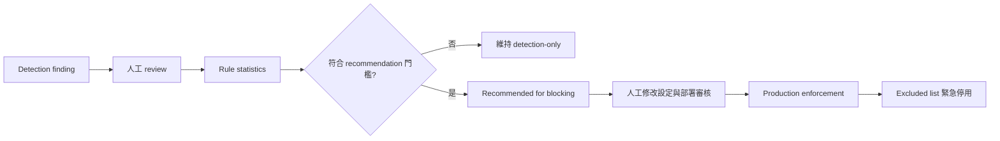

# 人工審查與規則升級

Gateway 將規則生命週期分為四個不同權限層級：

`recommended_for_blocking` 是統計結果，不會修改 `ATR_BLOCKING`、rule allow-list 或部署設定。

現有自動化證據：

- `test_admin_can_label_findings_and_get_blocking_recommendation`：人工判為 true positive 後可產生
  recommendation，但 Gateway 仍保持 detection-only。
- `test_false_positive_rate_prevents_blocking_recommendation`：樣本數達標但 false-positive rate
  超過門檻時，不會推薦 blocking。
- `test_atr_blocking_can_be_calibrated_with_rule_allow_and_exclude_lists`：allow-list 可限制阻擋規則，
  excluded list 可使規則繼續偵測但停止阻擋。

## 權限責任

- **ATR engine**：回傳規則 match、severity 與其他 finding metadata。
- **Gateway**：決定掃描位置、保存 review、計算 recommendation，並依已部署設定執行阻擋。
- **Operator／部署流程**：決定是否修改 production enforcement 設定。

因此，「規則命中」、「建議阻擋」與「取得 production 阻擋權限」不是同一件事。

## `ATR-2026-00213` 人工 review 實驗（2026-10-24）

以 `tests/fixtures/atr_00213_review_cases.json` 的 30 筆人工編寫、預先標記的合成 tool-result
樣本進行單一 reviewer 初評；其中 20 筆是 system-prompt override 攻擊，10 筆是安全文件、
release note、測試名稱等良性近似。尚未做第二位 reviewer 的獨立複核。
使用 `pyatr 0.3.1` bundled rules 執行後：

| 結果 | 筆數 |
| --- | ---: |
| True positive | 20 |
| False negative | 0 |
| True negative | 7 |
| False positive | 3 |

`ATR-2026-00213` 在這批樣本的命中共有 23 筆，人工 review 後 false-positive rate 為
`3 / 23 = 13.0%`；良性樣本誤報率為 `3 / 10 = 30.0%`。兩者分母不同，不應混用。

3 筆誤報分別來自描述「偵測 system prompt override」、「改善 prompt override 偵測」與
「沒有觀察到 bypass system instructions」的防禦／事件文字。由於 13.0% 高於 Gateway 預設
promotion 門檻 5%，目前結論是維持 detection-only，不將此規則加入 production blocking
allow-list。此結果只適用於這批刻意包含近似字句的合成樣本。
